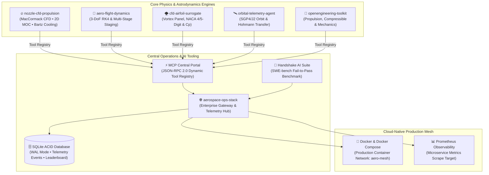

# Gopi Naga Vignesh Thirupati
### Aerospace & Computational Simulation Software Engineer
#### 3-DoF/6-DoF Dynamics • Multi-Stage Rocket Staging • SGP4 Orbit Propagation • Physics-Informed CFD • Handshake AI & SWE-bench • SQLite WAL • Docker & MCP

 

---

### 👨‍💻 About Me

I am an **Aerospace & Computational Simulation Software Engineer** specializing in translating complex physical dynamics, multi-stage rocket trajectories, orbital mechanics, and fluid flows into high-performance, test-driven software, containerized microservices, and **Model Context Protocol (MCP)** tools. My work enables autonomous AI systems (Claude, Cursor, Antigravity) to reason through and simulate atmospheric flight physics, satellite orbits, aerodynamic surfaces, and propulsion thermodynamics with deterministic precision.

- 🚀 **Core Focus:** Computational flight simulation, multi-stage vehicle staging, physics-informed AI surrogates, cloud-native aerospace microservices, zero-dependency ACID database persistence, and reproducible AI coding benchmarks (SWE-bench / Handshake AI).
- 🛠️ **Engineering Stack:** Python (NumPy, SciPy, Matplotlib), MATLAB / GNU Octave (`.m`), C++17 (`g++ -O3`), TypeScript, ParaView (`.vtk`), Pytest (192+ passing tests), SQLite (WAL mode), Docker, Docker Compose, GitHub Actions (CI/CD), Prometheus Observability, Linux.
- 📐 **Domain Expertise:** Conservative MacCormack Shock-Capturing CFD, 2D Method of Characteristics (MOC), Plume Shock Diamonds, Bartz Nozzle Regenerative Cooling (`GRCop-42` / `CuCrZr` / `Inconel 718`), Multi-Propellant Rocket Combustion (`Hydrolox`, `Methalox`, `Kerolox`, `Solid APCP`), 6-DoF Quaternions, Multi-Stage Rocket Staging, SGP4/J2 Orbits, 2D Supersonic Oblique Shocks, and Vortex Panel Methods.
- 🤖 **AI Benchmarking & Tooling:** Designing deterministic fail-to-pass test harnesses and golden patches for LLM code evaluation across physical ODEs and aerodynamic singularities.

---

### 🌐 Computational Aerospace & AI Architecture

---

### 🏛️ Systems & Tooling Architecture

| Category | Technologies & Tools |
|---|---|
| **Languages** | Python 3.10–3.12 (NumPy, SciPy, Matplotlib), MATLAB / GNU Octave (`.m`), C++17 (`g++ -O3`), TypeScript, Bash, SQL |
| **Software Engineering** | Pytest (192+ Automated Tests), Test-Driven Development (TDD), Docker, Docker Compose, GitHub Actions, Ruff, ParaView VTK |
| **Cloud & Microservices** | FastAPI, ASGI/Uvicorn, Prometheus Observability, REST Gateways, WebSocket Telemetry, Multi-stage Dockerfiles |
| **AI & Agent Tooling** | Model Context Protocol (MCP stdio/JSON-RPC), Handshake AI / SWE-bench Physical Simulation Benchmarks |
| **Aerospace & Flight Physics** | 6-DoF Quaternions & Euler Dynamics, 3-DoF RK4 Trajectory, Multi-Stage Staging & Casing Jettison, 1976 US Standard Atmosphere |
| **Astrodynamics & Ground** | SGP4/J2 Secular Oblateness, Hohmann & 3-Impulse Bi-Elliptic Transfers, Global Ground Station Network Handovers, WGS-84 Geodetic |
| **Computational Fluid Dynamics** | Karman-Tsien Transonic Critical Mach & Korn Drag Divergence, Vortex Panel Method, NACA 4-Digit & 5-Digit Geometry, Squire-Young Drag |
| **Thermodynamics & Compressible** | 2D Supersonic Oblique Shocks & $\theta-\beta-M$ Solvers, Isentropic Area-Mach Relations ($A/A^*$), Rankine-Hugoniot Normal Shocks, Tsiolkovsky Sizing |
| **CAD & Mechanical Analysis** | Siemens NX CAD, ANSYS, CATIA, SolidWorks, Geometric Dimensioning & Tolerancing (GD&T) |

---

### 🌟 Featured Flagship Repositories

#### 1. 🔥 [nozzle-cfd-propulsion](https://github.com/perfectalone375/nozzle-cfd-propulsion) (`v0.1.0` • [Beginner CFD Guide](https://github.com/perfectalone375/nozzle-cfd-propulsion/blob/main/BEGINNERS_GUIDE_CFD_AND_PROPULSION.md))
> **Multi-Propellant Rocket Propulsion & Supersonic Nozzle CFD Digital Twin (Python, MATLAB/Octave, C++17 & ParaView VTK)**  
> *Python (NumPy/SciPy/Matplotlib) • MATLAB/GNU Octave `.m` • C++17 (`g++ -O3`) • Docker • MCP Server • Multi-Language CI • MIT Licensed*

* **Multi-Propellant Thermochemistry:** Compares `HYDROLOX` (LOX/LH2), `METHALOX` (LOX/LCH4), `KEROLOX` (LOX/RP-1), and `SOLID_APCP` on Rao parabolic 80% bell nozzles with Summerfield flow separation detection.
* **Shock-Capturing MacCormack CFD & C++17/MATLAB Parity:** Solves Conservative Quasi-1D Euler flow capturing standing normal shocks inside overexpanded nozzles (`M1=2.56 -> M2=0.51`) alongside sub-millisecond C++17 and GNU Octave `.m` solver twins all verified green in CI.
* **2D Method of Characteristics & ParaView `.vtk`:** Computes Prandtl-Meyer characteristic wave fans and 2D exhaust plume shock diamonds (`nozzle_plume_field.vtk` + dark-theme Matplotlib charts).
* **Bartz Convective Nozzle Cooling & MCP:** Solves hot-gas convective flux (~56 MW/m²) across **GRCop-42**, **CuCrZr**, and **Inconel 718**, and exposes 4 MCP simulation tools (`nozzle-cfd-mcp`).

#### 2. 🌐 [aerospace-ops-stack](https://github.com/perfectalone375/aerospace-ops-stack) (`v0.3.0` • [Live Demo](https://perfectalone375.github.io/aerospace-ops-stack/))
> **Cloud-Native Aerospace Microservices Stack, SQLite ACID Persistence, JSON-RPC 2.0 MCP Central Portal & Handshake AI Sandboxed Code Evaluator**  
> *Python • Docker Compose • FastAPI • SQLite WAL • AST Subprocess Sandbox • CI/CD Matrix • 25 Automated Tests • MIT Licensed*

* **Central Mission Gateway & Observability:** Microservice hub orchestrating 3-DoF suborbital flight simulations, real-time SGP4 orbital propagation, supersonic nozzle CFD (`/api/simulation/nozzle-cfd`), and thread-safe Prometheus telemetry (`/metrics`).
* **Zero-Dependency SQLite Persistence:** Thread-safe ACID persistence with Write-Ahead Logging (WAL mode), configurable storage (`AERO_OPS_DB_PATH` + Docker volume), cascading foreign keys, and analytical SQL leaderboards (`/api/db/runs`, `/api/db/leaderboard`).
* **Native JSON-RPC 2.0 MCP Portal:** Full MCP `2024-11-05` support over both `stdio` (`aero-ops-mcp`) and HTTP (`POST /mcp`), exposing 7 physics simulation tools (`simulate_rocket_nozzle_cfd`, oblique shock, trajectory, attitude, transfer) and live DB resources.
* **Handshake AI Isolated Sandbox Evaluator:** AST security scanner + timeout-guarded `python -I` subprocess harness validating buggy starter code vs candidate fixes across 10 aerospace SWE-bench challenges (`AERO-001` through `AERO-010`).
* **Dual-Mode Mission Control UI & GitHub Pages:** Runs live against FastAPI + SQLite WAL locally/Docker or as a standalone interactive explorer featuring a **2D Nozzle CFD & Shock Diamond Heatmap Lab** at **[perfectalone375.github.io/aerospace-ops-stack](https://perfectalone375.github.io/aerospace-ops-stack/)**.

#### 3. 🔬 [aero-eval-benchmark](https://github.com/perfectalone375/aero-eval-benchmark)
> **Autonomous Evaluation Harness & SWE-bench Style Benchmark for Testing Coding LLMs on Aerospace & Physics Tasks**  
> *Python • SWE-bench Protocol • Docker • MCP Server • Multi-Python CI Matrix • 15 Automated Tests • MIT Licensed*

* **SWE-bench Standard Architecture:** Curated benchmark challenge matrix testing frontier LLMs on numerical singularities, transonic wave drag discontinuities, and orbital coordinate branch cuts.
* **Isolated Evaluation Harness:** Validates unified diff patches against rigorous fail-to-pass edge case tests while enforcing zero regressions on pass-to-pass baselines.
* **Frontier Model Leaderboard:** Benchmarked performance data for Claude 3.5 Sonnet, GPT-4o, DeepSeek-Coder, and Qwen-2.5-Coder on physical ODEs.
* **MCP Integration:** Exposes `aeroeval_list_tasks`, `aeroeval_get_task_spec`, and `aeroeval_evaluate_patch` for autonomous AI agents.

#### 4. 🌪️ [cfd-airfoil-surrogate](https://github.com/perfectalone375/cfd-airfoil-surrogate)
> **Physics-Informed CFD Aerodynamic Surrogate Model for Instantaneous Pressure ($C_p$), 5-Digit Geometry & Polars**  
> *Python • Docker • Docker Compose • MCP Server • UIUC Wind Tunnel Validation • 23 Automated Tests • MIT Licensed*

* **Instantaneous Prediction (<2 ms):** Generates chordwise surface pressure distributions ($C_p(x/c)$) and aerodynamic polars ($C_L, C_D, C_M, L/D$) 23,000x faster than 2D OpenFOAM RANS.
* **NACA 4 & 5-Digit Airfoils:** Parametric cubic camber generator supporting high-performance 5-digit airfoils (e.g. NACA 23012) and 4-digit profiles.
* **Pitching Moment & Center of Pressure:** Quarter-chord moment ($C_{m, c/4}$), leading-edge moment ($C_{m, LE}$), and center of pressure ($x_{cp} / c$) stability modeling.
* **Vortex Panel & Boundary Layer:** Cosine leading-edge clustering, Kutta closure, and Squire-Young profile drag with stall roll-off.

#### 5. 🛰️ [orbital-telemetry-agent](https://github.com/perfectalone375/orbital-telemetry-agent)
> **Autonomous Satellite Orbit Propagator, Hohmann Transfer Calculator & Model Context Protocol (MCP) Server**  
> *Python • Docker • Docker Compose • Multi-Python CI Matrix • 20 Automated Tests • MIT Licensed*

* **Astrodynamics & J2 Perturbation:** Keplerian orbit propagator modeling Earth oblateness ($J_2 = 1.08263 \times 10^{-3}$), nodal regression ($\dot{\Omega}$), and argument of perigee precession ($\dot{\omega}$).
* **Orbital Transfers & Maneuvers:** Two-impulse Hohmann transfer delta-v budgets ($\Delta v_1, \Delta v_2$), transfer duration ($t_{\text{tof}}$), and combined apogee plane change optimization.
* **Ground Station Tracking:** Topocentric SEZ coordinate transformation predicting satellite Acquisition of Signal (AOS), Loss of Signal (LOS), max elevation, and pass schedules.
* **RF Doppler Telemetry:** Real-time line-of-sight range rate and RF Doppler frequency shift calculations for satellite radios.

#### 6. 🚀 [aero-flight-dynamics](https://github.com/perfectalone375/aero-flight-dynamics)
> **High-Fidelity 3-DoF Aerospace Simulation Engine, Multi-Stage Staging & Model Context Protocol (MCP) Server**  
> *Python • Docker • Docker Compose • Multi-Python CI Matrix • 43 Automated Tests • MIT Licensed*

* **Multi-Stage Vehicle Dynamics:** Discrete stage separation, dry mass casing jettison, inter-stage coast, and sustainer ignition modeling.
* **MCP Server Integration:** Exposes JSON-RPC 2.0 tools for Claude Desktop, Cursor, and AI agents to simulate 3-DoF flights, staged trajectories, evaluate atmospheric layers, and analyze airfoils.
* **Atmospheric Physics:** Exact 7-layer 1976 U.S. Standard Atmosphere model up to 86,000 meters geopotential altitude with Sutherland dynamic viscosity law.
* **Compressible Aerodynamics:** Prandtl-Glauert subsonic compressibility corrections, Lock/Korn transonic wave drag divergence with non-linear saturation clamping ($C_{D,\text{wave}} \le 0.40$).
* **Numerical Solver:** 4th-order Runge-Kutta (RK4) integrator tracking altitude, Mach number, axial G-load, dynamic pressure (Max-Q), and telemetry data.

#### 7. 📐 [openengineering-toolkit](https://github.com/perfectalone375/openengineering-toolkit)
> **Transparent, Verified Computational Mechanics, Compressible Gas Dynamics & Rocket Propulsion Library**  
> *Python • FastAPI • Docker • Docker Compose • CLI • MCP Server • 57 Automated Tests • MIT Licensed*

* **Compressible Gas Dynamics:** Isentropic temperature and density ratios ($T_0/T, \rho_0/\rho$), nozzle sonic throat area ratio ($A/A^*$), Rankine-Hugoniot 1D normal shock jumps ($M_2, P_2/P_1, P_{02}/P_{01}$), and Prandtl-Meyer expansion angle ($\nu(M)$).
* **Rocket Propulsion Analytics:** Tsiolkovsky delta-v, characteristic exhaust velocity $c^*$, nozzle thrust coefficient $C_F$, and total thrust.
* **Fluid Dynamics & Sizing:** Reynolds number regime verification, dynamic pressure $q$, compressible Mach number, and Haaland pipe friction.
* **Structural Solid Mechanics:** Euler-Bernoulli mid-span beam deflection, bending stress, and factor of safety (FoS).

---

### 🏆 GitHub Profile Achievements

| ⚡ Quickdraw | 🦈 Pull Shark (Silver • 26 PRs) | 👥 Pair Extraordinaire | 🚀 YOLO |
|:---:|:---:|:---:|:---:|
| Closed issue within 5m | 26 Merged Pull Requests | Co-authored merged commits | Merged PR without code review |

---

### 📊 GitHub Dynamic Activity & Stats

---

### 📫 Connect With Me
* **Email:** [gopinagavignesh375@gmail.com](mailto:gopinagavignesh375@gmail.com)
* **LinkedIn:** [linkedin.com/in/vignesh375](https://linkedin.com/in/vignesh375)
* **GitHub Profile:** [github.com/perfectalone375](https://github.com/perfectalone375)
